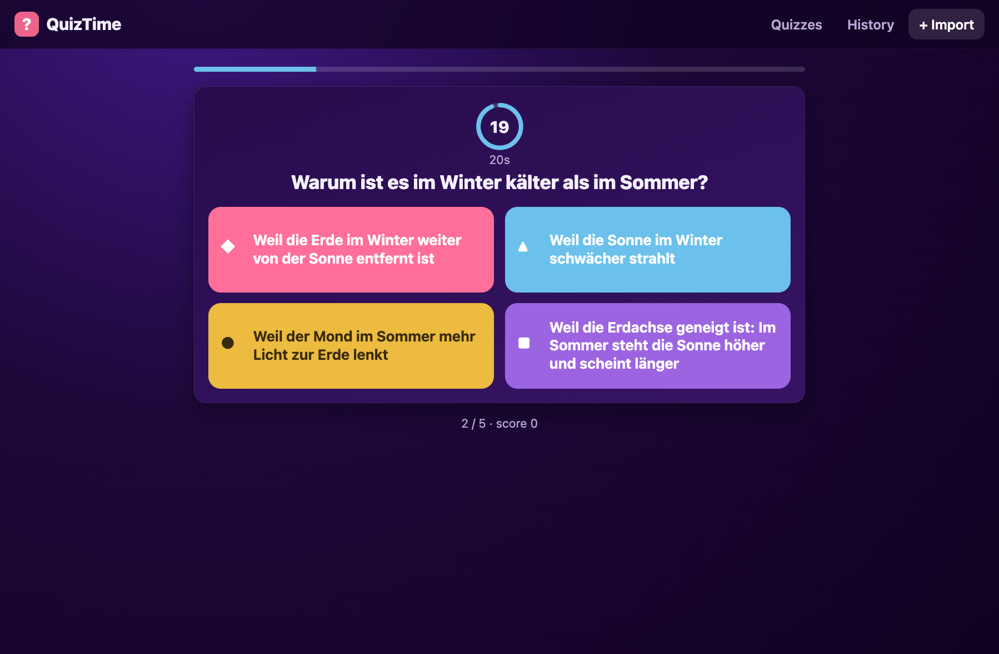
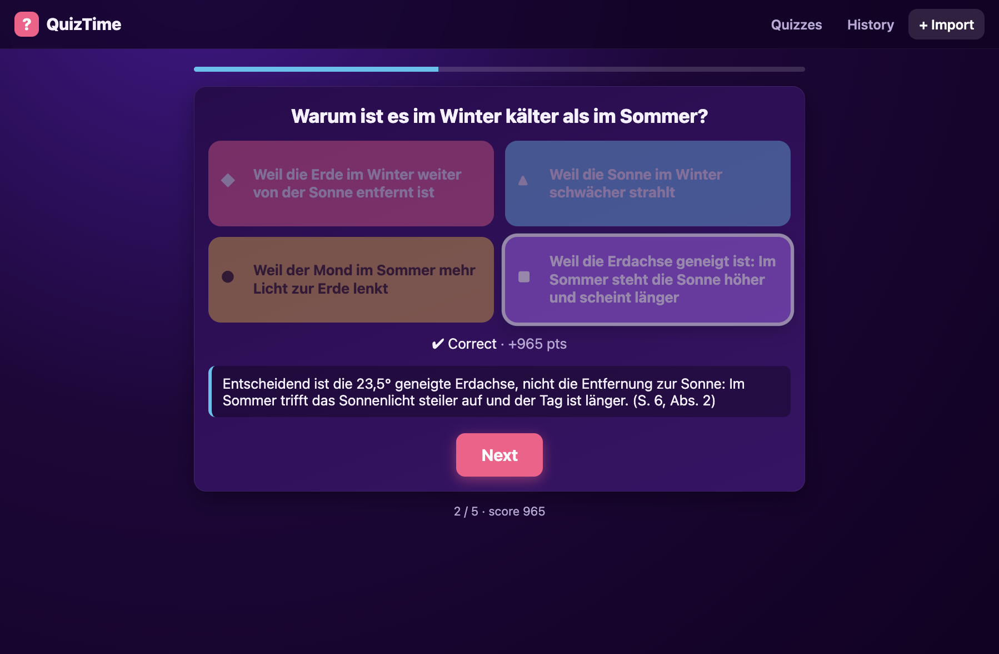

# QuizTime

A Kahoot-style, single-player quiz PWA. Import questions from CSV (your format or Kahoot exports) or share `.quiz` files into the app, play timed (Kahoot-style scoring) or untimed (school-test practice) rounds, and keep a local history of your results. Everything lives on-device in IndexedDB — no account, no backend, works offline once installed.

<p align="center">
  
  &nbsp;
  
</p>

## Features

- **Kahoot feel** — shape-coloured answers, countdown timer, points with speed bonus; practice mode without a timer.
- **Every answer gets an explanation**, shown right or wrong, so a wrong answer still teaches.
- **Import anywhere** — file picker, drag-and-drop, share a `.quiz`/`.csv` into the installed PWA, or double-click a `.quiz` file.
- **Offline-first PWA** — installable; quizzes, scores, and images persist on the device; interrupted rounds can be resumed.

## Quick start

```bash
npm install
npm run dev        # https://localhost:5173 (LAN HTTPS setup for phone installs: see docs)
npm run test       # vitest suite
```

Serving over LAN HTTPS with mkcert (for installing the PWA on a phone and using the share target), offline hosting options, and the dev-only quiz builder are covered in [docs/development.md](docs/development.md).

## Getting quizzes in

The simple CSV format — `correct` is the 1-based answer index, `explanation` is shown after every answer:

```csv
question,answer1,answer2,answer3,answer4,correct,explanation
Capital of Switzerland?,Zurich,Bern,Geneva,Basel,2,Bern is the federal city
2 + 2?,3,4,5,6,2,2 + 2 equals 4.
```

One correct answer per question — the app is single-choice. Kahoot-export CSVs are auto-detected, and `.quiz` packages (zip with `quiz.json` + images) round-trip photos and attribution. Full details: [docs/quiz-format.md](docs/quiz-format.md).

### Generate quizzes with ChatGPT / Codex

This repo ships an agent skill, [`quiz-csv-creator`](.agents/skills/quiz-csv-creator/SKILL.md), that turns any teaching text (chapter, PDF, notes) into an import-ready CSV in the format above. Its question rules follow learning-science research (retrieval practice, misconception-based distractors, elaborated feedback) and a bundled validator enforces the output contract. Use `@quiz-csv-creator` in ChatGPT or `$quiz-csv-creator` in Codex; it follows the open [Agent Skills](https://agentskills.io/specification) format.

## Scoring

| Mode | Points |
|---|---|
| Timed | correct = 500 + time bonus up to 500 (`500 * remaining/total`, rounded) |
| Practice (untimed) | correct = 500, no timer |

The mode is chosen per game; best/last score and every run are kept per quiz. Deleting a quiz also removes its history and any images no other quiz uses.
